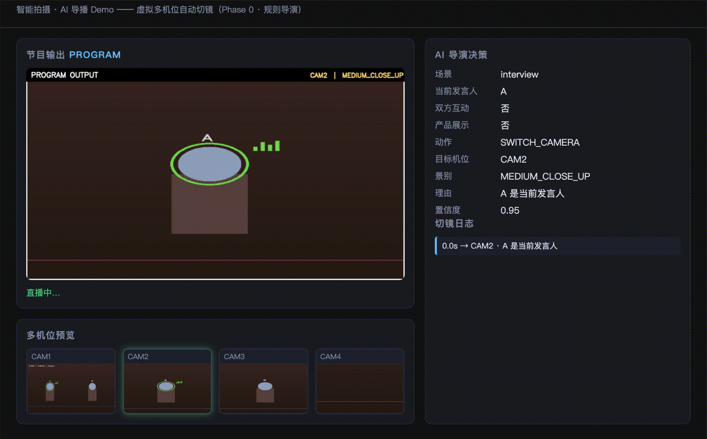
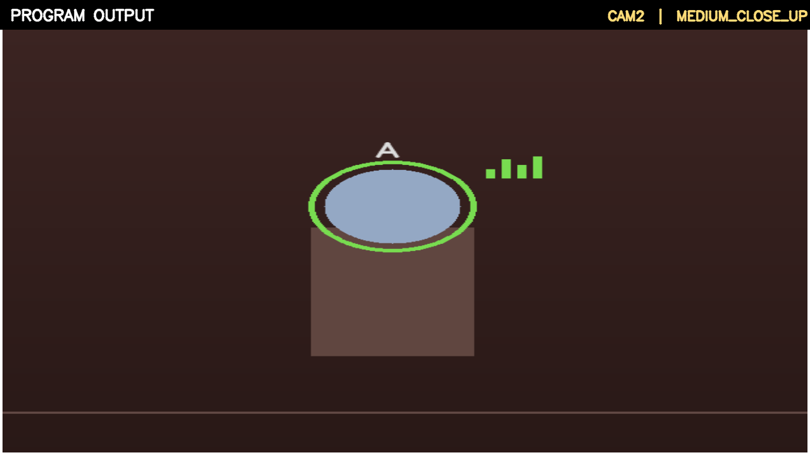
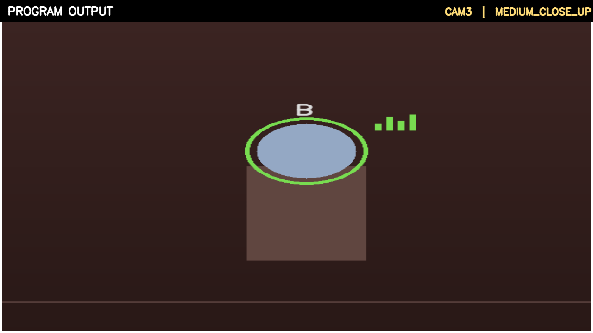
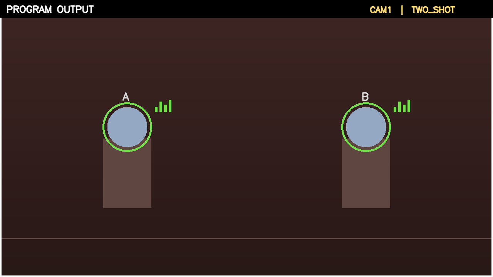
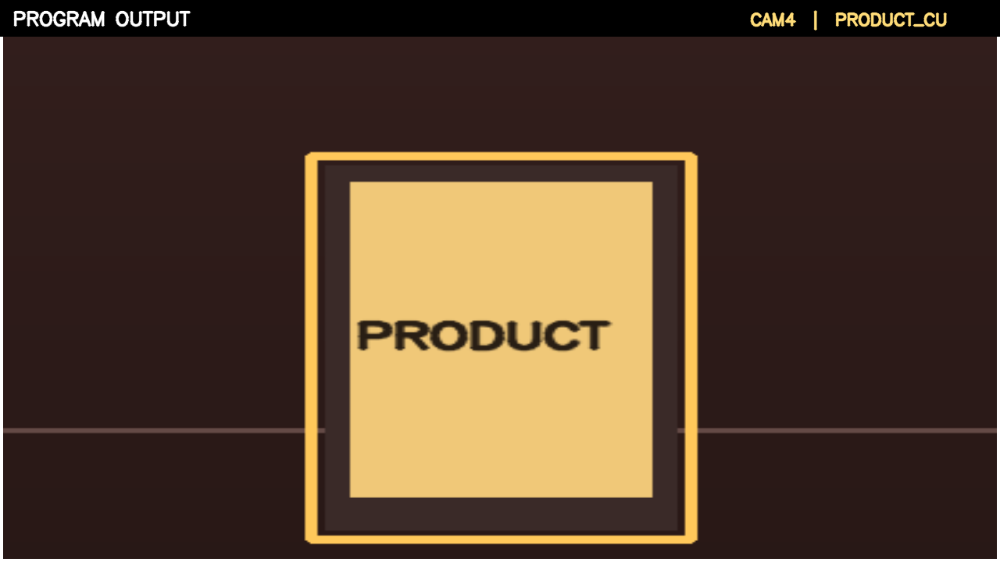

# AI Live Director v0.1

**智能拍摄 · AI 导播 Demo** —— 一个能理解直播现场、并自主决定「拍谁、用什么景别、何时切机」的 AI 导播 Agent。

> 核心闭环：`Video Perception → World State → Director → Camera Action → Program Output`

本仓库是 **Phase 0（规则导演 + 虚拟多机位）**：不依赖任何 ML 模型（无 torch / yolo / vlm），
用 OpenCV 合成「两人访谈」场景，跑通「感知 → 决策 → 切镜 → 成片」的完整闭环，
并预留 VLM / LLM / VLA / 真实 PTZ 的接口，供后续渐进替换。

---

## ✨ 特性

- **闭环架构**：`Perception → WorldState → Director → CameraAction → Program Output`，模块解耦。
- **统一接口**：定义 `WorldState`（Observation）与 `CameraAction`（Action），与底层硬件/模型解耦。
- **导演状态机**：IDLE / FOCUS_A / FOCUS_B / TWO_SHOT / PRODUCT，事件优先级清晰。
- **防抽风切镜**：最小镜头时长约束，避免「1 秒一切」。
- **可解释**：每个决策带 `reason` / `confidence`，回答「为什么这么拍」。
- **可评测**：切镜频率、平均镜头时长、不合理切镜率、事件覆盖率等指标。
- **数据飞轮**：每次决策写入 `DecisionLog`（JSONL），即未来 VLA 训练数据的雏形。
- **两种运行方式**：CLI 离线成片 + 浏览器实时 Dashboard。

---

## 🧭 架构

```text
                    User Instruction（如「重点拍讲话的人」）
                                  │
                                  ▼
   Video ──▶ Perception ──▶ World State ──▶ Director ──▶ Camera Action ──▶ Switcher ──▶ Program
  (合成)      (Mock/可换)     (统一中间层)     (规则/可换)     (高层动作)      (虚拟多机位)    (PGM)
```

- **Perception**：`MockPerception`（脚本化时间线），后续替换为 YOLO + 说话人检测 + VLM。
- **WorldState**：把人物 / 说话人 / 事件 / 机位统一为结构化状态，是未来 VLA 的 Observation。
- **Director**：`RuleBasedDirector`（规则 + 状态机），后续替换为 LLM / VLM / VLA。
- **CameraAction**：高层摄影动作（`SWITCH_CAMERA` / `SHOT` / `HOLD` / `ZOOM`…），与硬件解耦。
- **Switcher**：`VirtualCamera` 对合成帧做 ROI 裁切，模拟多机位切镜。

详细设计见 [`docs/DESIGN.md`](docs/DESIGN.md)，数据流见 [`docs/ARCHITECTURE.md`](docs/ARCHITECTURE.md)。

---

## 🚀 快速开始

要求：**Python 3.9+**（零模型依赖）。

```bash
git clone <your-repo-url>
cd ai-live-director

python3 -m venv .venv
source .venv/bin/activate          # Windows: .venv\Scripts\activate
pip install -r requirements.txt
```

### 方式一：离线跑通闭环（生成成片 + 决策日志）

```bash
python -m app.main
```

产出：

```text
outputs/
├── program.mp4          # AI 自动导播的最终成片
└── director_log.jsonl   # 每一次导演决策（Observation → Decision → Action）
```

控制台会打印切镜过程与最终指标：

```text
[   0.0s] speaker=A interaction=False product=False
   => SWITCH_CAMERA CAM2 | A 是当前发言人
[   5.0s] speaker=B interaction=False product=False
   => SWITCH_CAMERA CAM3 | B 是当前发言人
...
导演指标：
  切镜次数        : 5
  平均镜头时长    : 5.0s
  不合理切镜数    : 0（Bad Cut Rate = 0.0）
  事件覆盖率      : 100.0%
```

### 方式二：实时 Dashboard（浏览器）

```bash
python -m app.server
# 或 uvicorn app.server:app
```

打开 <http://127.0.0.1:8000>，可实时看到：

- 节目输出（PGM）主画面；
- 4 个机位预览（当前机位高亮）；
- AI 导演决策面板（场景 / 发言人 / 动作 / 机位 / 景别 / 理由 / 置信度）；
- 切镜日志。

### 单元测试

```bash
pip install -r requirements-dev.txt
python -m pytest -q
```

---

## 🎬 效果展示

**实时 Dashboard 最终效果**（浏览器打开 `http://127.0.0.1:8000`，AI 依据现场事件自动切镜）：



AI 导播依据现场事件自动切镜（合成两人访谈场景）：

| A 讲话 → CAM2 中近景 | B 讲话 → CAM3 中近景 | 双方互动 → CAM1 双人 | 产品展示 → CAM4 特写 |
|---|---|---|---|
|  |  |  |  |

> 生成方式：`python -m app.main` 运行后可运行 `python scripts/export_frames.py` 导出上述截图。

---

## 🗂 目录结构

```text
ai-live-director/
├── app/
│   ├── schemas.py             # WorldState / CameraAction / ShotType ...
│   ├── engine.py              # 闭环引擎
│   ├── main.py                # CLI 离线入口
│   ├── server.py              # FastAPI + WebSocket Dashboard
│   ├── perception/            # mock.py（时间线）/ vlm_adapter.py（占位）
│   ├── world/                 # state_manager.py
│   ├── director/              # rule_based.py / state_machine.py / llm_director.py（占位）
│   ├── camera/                # simulator.py / virtual_camera.py / ptz_adapter.py（占位）
│   ├── switcher/              # switcher.py
│   ├── evaluation/            # shot_quality.py / director_metrics.py
│   └── utils/                 # decision_log.py / video_writer.py
├── configs/                   # cameras.yaml / director.yaml
├── tests/                     # 单元测试
├── scripts/                   # run_demo.py / run_dashboard.py / export_frames.py
├── datasets/                  # 预留（真实视频/标注）
└── docs/                      # DESIGN.md / ARCHITECTURE.md
```

---

## 📈 Roadmap

| 阶段 | 决策层 | 感知层 | 执行层 | 状态 |
|---|---|---|---|---|
| **Phase 0** | 规则导演 + 状态机 | Mock（时间线） | 虚拟多机位（crop） | ✅ 本仓库 |
| Phase 1 | LLM / VLM 导演 | YOLO + 说话人检测 + VLM | 虚拟多机位 + 真实视频 | 🔜 |
| Phase 2 | 同上 | 同上 | 真实 PTZ（VISCA / ONVIF） | 🔜 |
| Phase 3 | VLA Policy | 端到端 Observation | Camera Agent | 🔜 |

---

## 📄 License

[MIT](LICENSE)
